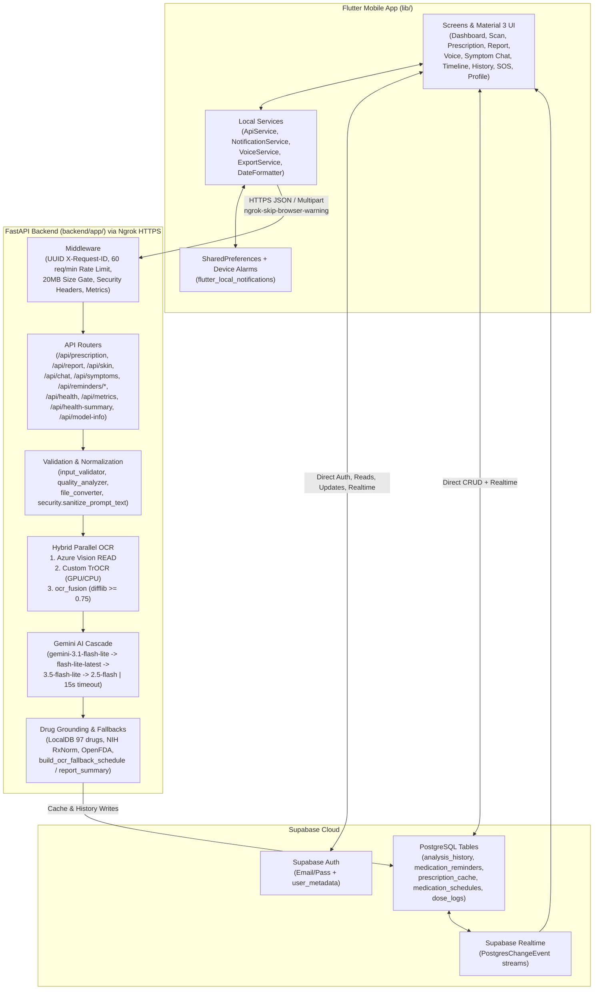

# MedIntel (MedBuddy) — Complete Technical & Architectural Documentation

> **Document Purpose:** Exhaustive end-to-end reference covering every module, service, endpoint, ML model, database interaction, UI screen, widget, safety layer, and configuration in the **MedIntel** (`MedBuddy`) codebase for presentation and technical defense.

---

## Table of Contents

1. [Project Overview & Executive Summary](#1-project-overview--executive-summary)
2. [Complete Technology Stack & Dependencies](#2-complete-technology-stack--dependencies)
3. [System Architecture & End-to-End Data Flow](#3-system-architecture--end-to-end-data-flow)
4. [Complete Repository & File Inventory](#4-complete-repository--file-inventory)
5. [Backend Deep-Dive (`backend/app/`)](#5-backend-deep-dive-backendapp)
   - [5.1 FastAPI Entrypoint, Middleware & Security Headers (`main.py`)](#51-fastapi-entrypoint-middleware--security-headers-mainpy)
   - [5.2 Resilience, Rate Limiting, Metrics & Health (`resilience.py`)](#52-resilience-rate-limiting-metrics--health-resiliencepy)
   - [5.3 Complete API Endpoints Reference](#53-complete-api-endpoints-reference)
   - [5.4 Input Validation, Image Quality & File Normalization](#54-input-validation-image-quality--file-normalization)
   - [5.5 Hybrid OCR Engine (Azure Vision + Custom TrOCR + Fuzzy Fusion)](#55-hybrid-ocr-engine-azure-vision--custom-trocr--fuzzy-fusion)
   - [5.6 Text Cleaning, Candidate Extraction & Medicine Verification](#56-text-cleaning-candidate-extraction--medicine-verification)
   - [5.7 Multimodal AI Pipelines & Deterministic Fallbacks](#57-multimodal-ai-pipelines--deterministic-fallbacks)
   - [5.8 Caching, Persistence, Logging, Security & Auxiliary Safety Modules](#58-caching-persistence-logging-security--auxiliary-safety-modules)
6. [Custom Medical OCR & ML Training Pipeline (`custom_medical_ocr/`)](#6-custom-medical-ocr--ml-training-pipeline-custom_medical_ocr)
   - [6.1 Model Architecture (`VisionEncoderDecoderModel`)](#61-model-architecture-visionencoderdecodermodel)
   - [6.2 Stage 1: Word-Level Medical Handwriting TrOCR (`train_trocr.py`)](#62-stage-1-word-level-medical-handwriting-trocr-train_trocrpy)
   - [6.3 Stage 2: Prescription Dataset Creation, Cleaning & Categorization](#63-stage-2-prescription-dataset-creation-cleaning--categorization)
   - [6.4 Stage 2 Experimental Full-Page Fine-Tuning & Key Findings](#64-stage-2-experimental-full-page-fine-tuning--key-findings)
7. [Frontend Flutter Application Deep-Dive (`lib/`)](#7-frontend-flutter-application-deep-dive-lib)
   - [7.1 App Bootstrap, Global State & Material 3 Themes (`main.dart`)](#71-app-bootstrap-global-state--material-3-themes-maindart)
   - [7.2 Frontend Services (`lib/services/`)](#72-frontend-services-libservices)
   - [7.3 Navigation Shell (`main_navigation.dart`)](#73-navigation-shell-main_navigationdart)
   - [7.4 Complete Screen-by-Screen Breakdown (`lib/screens/`)](#74-complete-screen-by-screen-breakdown-libscreens)
   - [7.5 Reusable UI Widgets (`lib/widgets/`)](#75-reusable-ui-widgets-libwidgets)
   - [7.6 Native Android & iOS Configuration](#76-native-android--ios-configuration)
8. [Database Schema & State Synchronization (Supabase)](#8-database-schema--state-synchronization-supabase)
9. [Security, Anti-Hallucination Safety & Automated Tests](#9-security-anti-hallucination-safety--automated-tests)
10. [Implementation Nuances & Presentation Q&A Cheat Sheet](#10-implementation-nuances--presentation-qa-cheat-sheet)

---

## 1. Project Overview & Executive Summary

**MedIntel** (repository folder `MedBuddy`, Flutter package `medintel`, Android package `com.example.medintel`) is an end-to-end **AI-powered Personal Medical Assistant** consisting of a cross-platform **Flutter** mobile/client app and a **Python FastAPI** AI backend backed by **Supabase** (Authentication, PostgreSQL, Realtime), **Microsoft Azure AI Vision 4.0**, a **custom fine-tuned PyTorch/Hugging Face TrOCR model**, **Google Gemini multimodal LLMs**, and **NIH RxNorm / OpenFDA** drug verification APIs.

### Core Problems Solved
1. **Illegible Doctor Prescriptions:** Patients struggle to read handwritten prescriptions, understand why each medicine was prescribed, or remember dosing intervals (`1-0-1`, `BD`, `OD`, `TDS`, `SOS`, before/after food).
2. **Complex Lab & Diagnostic Reports:** Medical reports (CBC, LFT, KFT, Lipid, HbA1c, Thyroid, Urine, Radiology/Cardiology) contain dense numbers and reference ranges without plain-language clinical explanations.
3. **Medication Adherence:** Patients forget doses or miss schedules without automated, personalized reminders synced across local device alarms and cloud state.
4. **Language Barriers:** Medical explanations are often only in English; MedIntel translates AI output and full UI across **6 languages**:
   - **English** (`en`)
   - **Hindi** (`hi` — हिंदी)
   - **Kannada** (`kn` — ಕನ್ನಡ)
   - **Tamil** (`ta` — தமிழ்)
   - **Malayalam** (`ml` — മലയാളം)
   - **Telugu** (`te` — తెలుగు)
5. **Accessible Health Guidance & Emergency Response:** Voice-first Q&A grounded in the user's own recent medical history, structured symptom checking, skin image advisory, longitudinal health timeline, PDF/text export, and one-tap SOS emergency calling/mapping.

---

## 2. Complete Technology Stack & Dependencies

### 2.1 Frontend (`pubspec.yaml`)
- **SDK:** Dart `>=3.0.0 <4.0.0`, Flutter Material 3 (`useMaterial3: true`)
- **Networking & Env:**
  - `http: ^1.6.0` (REST + Multipart uploads to FastAPI backend)
  - `flutter_dotenv: ^6.0.0` & `dotenv: ^4.2.0` (loads `.env` asset at startup for `SUPABASE_URL` and `SUPABASE_ANON_KEY`)
- **Backend-as-a-Service & Local Persistence:**
  - `supabase_flutter: ^2.12.0` (Auth, PostgreSQL queries, Realtime `PostgresChangeEvent` channels)
  - `shared_preferences: ^2.5.5` (local persistence of theme, language, and meal-slot medicine timings)
- **Media, Files & Export:**
  - `image_picker: ^1.2.1` (camera & gallery image capture)
  - `file_picker: ^11.0.3` (PDF selection for medical reports)
  - `path_provider: ^2.1.5` (copies picked files into app documents directory)
  - `pdf: ^3.12.0` & `printing: ^5.14.3` (A4 multi-page PDF generation and native print/save dialog)
  - `share_plus: ^12.0.1` (system share sheet for plain-text cleaned summaries)
  - `flutter_markdown: ^0.7.7+1` (renders structured AI markdown responses with styled headings, bullets, and callout blockquotes)
- **Notifications & Timezones:**
  - `flutter_local_notifications: ^21.0.0` (exact Android `exactAllowWhileIdle` & iOS local alarms)
  - `timezone: ^0.11.0` & `flutter_timezone: ^5.0.1` (device local timezone resolution)
  - `intl: ^0.19.0` (date/time formatting & IST conversions)
- **Voice, Permissions, Location & Emergency:**
  - `speech_to_text: ^7.3.0` (real-time microphone STT in 6 Indian/English locales)
  - `flutter_tts: ^4.2.5` (multi-language Text-to-Speech)
  - `permission_handler: ^12.0.1` (notification, speech, microphone permissions)
  - `url_launcher: ^6.3.2` (phone dialer `tel:108/100/101` & external Google Maps search)
  - `geolocator: ^14.0.2` (declared in `pubspec.yaml` for location capability)
- **Timeline & UI:**
  - `timeline_tile: ^2.0.0` & `timelines_plus: ^2.0.0` (longitudinal health timeline UI)
  - `cupertino_icons: ^1.0.6`

### 2.2 Backend (`backend/requirements.txt` & Runtime Libraries)
- **Web Framework:** `fastapi==0.129.0`, `uvicorn==0.41.0`, `starlette==0.52.1`, `pydantic==2.12.5`, `anyio==4.12.1`
- **Cloud AI & Vision:**
  - `google-genai==1.63.0` (Gemini Multimodal & Text APIs)
  - `azure-ai-vision-imageanalysis==1.0.0` & `azure-core==1.38.2` (Azure Vision 4.0 Read OCR + Tags/Caption)
- **Local Deep Learning OCR:**
  - `torch`, `transformers` (`4.46.3` per model config), `Pillow==12.1.1`, `opencv-python` (`cv2`), `numpy`
- **Document & Image Processing:**
  - `pypdf` (PDF validation & native digital text extraction)
  - `pypdfium2` (PDF-to-JPEG rendering at 160 DPI, up to 6 pages)
  - `pillow_heif` (optional HEIC/HEIF iPhone image support)
- **Database, HTTP & Config:**
  - `supabase==2.13.0`
  - `httpx` (async lookups to NIH RxNorm and OpenFDA)
  - `requests` (used in `translator.py` for Azure Cognitive Translator)
  - `python-dotenv==1.0.1`
  - `pytest` (automated backend test suite)

### 2.3 Environment Variables Used (Variable Names Only)
- **Root `.env` (Flutter asset):**
  - `SUPABASE_URL`
  - `SUPABASE_ANON_KEY`
- **Backend `.env` (`backend/.env`):**
  - `GEMINI_API_KEY`
  - `AZURE_VISION_ENDPOINT`
  - `AZURE_VISION_KEY`
  - `SUPABASE_URL`
  - `SUPABASE_ANON_KEY`
  - `AZURE_TRANSLATOR_KEY` / `AZURE_TRANSLATOR_ENDPOINT` (optional, used in `translator.py`)

---

## 3. System Architecture & End-to-End Data Flow

### Key Architectural Pattern: Dual Cloud Sync + Resilient Fallbacks
1. **Direct Client-to-Supabase Path:** Authentication (`LoginScreen`, `SignupScreen`, `ProfileScreen`, `PrivacySecurityScreen`), reading/deleting `analysis_history`, reading/updating/snoozing/deleting `medication_reminders`, and Realtime UI updates happen directly between Flutter and Supabase.
2. **Client-to-FastAPI AI Path:** Heavy compute (image/PDF normalization, parallel Azure OCR + PyTorch TrOCR, Gemini multimodal reasoning, drug authority verification) runs on the FastAPI server (`ApiService.baseUrl = "https://kathline-subcutaneous-irreconcilably.ngrok-free.dev/api"`). FastAPI also persists analysis outputs to Supabase `analysis_history`, caches prescription analyses in `prescription_cache`, and mirrors schedules into `reminder_service`.
3. **Zero-Crash Fallbacks:** If Gemini times out or fails across all 4 candidate models, deterministic OCR-based builders (`build_ocr_fallback_schedule`, `build_ocr_fallback_report_summary`) synthesize valid structured schedules and clinical markdown summaries directly from OCR lines. If Supabase is unreachable or blocked by RLS, `supabase_client.py` and `reminder_service.py` keep in-memory state so endpoints still succeed.

---

## 4. Complete Repository & File Inventory

### 4.1 Root Files
- `pubspec.yaml` / `pubspec.lock`: Flutter manifest and dependency lockfile.
- `analysis_options.yaml`: Dart analyzer/lint configuration.
- `requirements.txt`: Top-level Python subset dependencies.
- `README.md`: Default Flutter starter readme.
- `pyrightconfig.json`: Python static type checker configuration.
- `assets/images/logo.png`, `assets/images/logo_fg.png`: App branding assets.
- `test/widget_test.dart`: Default Flutter counter smoke test template (note: not updated to test `MedIntelApp` auth flow).

### 4.2 Backend (`backend/`)
- `backend/README.md`: Backend setup and `uvicorn app.main:app --reload --port 8000` instructions.
- `backend/requirements.txt`: Pinned backend Python dependencies.
- `backend/app/main.py`: FastAPI initialization, middleware, exception handlers, router registration.
- `backend/app/schemas/response.py`: `BasicResponse` Pydantic model (`success: bool`, `message: str`).
- `backend/app/data/medicines_db.json`: Curated JSON database of **97** common Indian/international medicines (`brand`, `generic`, `category`).
- `backend/app/routes/`:
  - `health.py`: `GET /api/health`, `GET /api/metrics`, `GET /api/health-summary`
  - `model.py`: `GET /api/model-info`
  - `prescription.py`: `POST /api/prescription`
  - `report.py`: `POST /api/report`
  - `skin.py`: `POST /api/skin`
  - `chat.py`: `POST /api/chat`
  - `symptoms.py`: `POST /api/symptoms`
  - `reminders.py`: `POST /api/reminders/save`, `GET /api/reminders/schedules`, `POST /api/reminders/dose-log`, `GET /api/reminders/dashboard`
- `backend/app/services/` (33 Python modules):
  - **Active Pipeline Services:** `input_validator.py`, `quality_analyzer.py`, `file_converter.py`, `ocr.py`, `trocr_service.py`, `ocr_fusion.py`, `text_cleaner.py`, `prescription_ai.py`, `medicine_verifier.py`, `medicine_db.py`, `prescription_validator.py`, `cache_service.py`, `report_validator.py`, `report_summarizer.py`, `skin_analysis.py`, `gemini_chat.py`, `reminder_service.py`, `supabase_client.py`, `resilience.py`, `security.py`, `structured_logger.py`, `model_info.py`.
  - **Modular / Audit-Tested / Legacy Helper Services:** `document_classifier.py`, `ocr_confidence.py`, `multi_prescription_detector.py`, `handwritten_classifier.py`, `hallucination_guard.py`, `ai_safety.py`, `medicine_extractor.py`, `medicine_validator.py`, `prescription_explainer.py`, `custom_ocr_info.py`, `translator.py`.
- `backend/tests/`:
  - `test_file_converter.py`: 4 pytest tests for PNG, JPG, PDF, and HEIC/HEIF handling.
  - `test_safety_audit.py`: 19 pytest unit/async tests covering Phases 1–19 safety modules.

### 4.3 Custom Medical OCR (`custom_medical_ocr/`)
- `train_trocr.py`: Stage 1 fine-tuning script (`microsoft/trocr-base-handwritten` → `models/trocr_medical_ocr`).
- `generate_prescription_labels.py`: Pseudo-labeling script calling backend Azure Vision OCR on 129 prescription images.
- `clean_prescription_labels.py`: Cleans raw OCR CSV using `gemini-2.5-flash` (removes hospital headers, phone numbers, emails, registration IDs) and produces `cleaning_report.csv`.
- `categorize_labels.py`: Regex keyword classifier sorting cleaned labels into `PRESCRIPTION`, `MEDICAL_REPORT`, `CERTIFICATE`, `LETTER`, `OTHER`.
- `train_prescription_trocr.py`: Stage 2 fine-tuning script (`models/trocr_medical_ocr` → `models/trocr_prescription_ocr`) on `prescription_only.csv` (93 samples).
- `compare_stage1_predictions.py` & `stage1_vs_prescription_test.csv`: Evaluation script comparing Stage 1 word-level TrOCR predictions against full-page Stage 2 validation rows.
- `check_dataset.py` & `missing_images.txt`: Integrity verification script checking every CSV entry in `training_labels.csv` exists on disk (0 missing).
- `dataset/`: `training_labels.csv` (3,120 rows), `validation_labels.csv` (780 rows), `testing_labels.csv` (780 rows) + `training_words/`, `validation_words/`, `testing_words/`, `Sample.jpeg`.
- `prescription_dataset/`: `images/` (129 images), `prescription_labels.csv` (129 rows), `cleaned_labels.csv` (129 rows), `cleaning_report.csv`, `categorized_labels.csv` (129 rows), `prescription_only.csv` (93 rows).
- `models/`: `trocr_medical_ocr/` (Stage 1, active in production) and `trocr_prescription_ocr/` (Stage 2 experimental).
- `trocr_results/` (`checkpoint-1560`, `checkpoint-2340`) & `trocr_prescription_results/` (`checkpoint-52`, `checkpoint-100`).

### 4.4 Frontend (`lib/`)
- `lib/main.dart`
- `lib/services/`: `api_service.dart`, `date_formatter.dart`, `export_service.dart`, `notification_service.dart`, `voice_service.dart`
- `lib/screens/`: `main_navigation.dart`, `login_screen.dart`, `signup_screen.dart`, `dashboard_screen.dart`, `scan_screen.dart`, `prescription_screen.dart`, `report_screen.dart`, `skin_screen.dart`, `voice_screen.dart`, `symptom_chat_screen.dart`, `sos_screen.dart`, `health_timeline_screen.dart`, `history_screen.dart`, `profile_screen.dart`, `settings_screen.dart`, `privacy_security_screen.dart`
- `lib/widgets/`: `custom_button.dart`, `empty_state_widget.dart`, `insight_card.dart`, `loading_skeleton.dart`, `medicine_card.dart`, `quick_action_card.dart`, `section_header.dart`, `statistic_card.dart`, `timeline_card.dart`

---

## 5. Backend Deep-Dive (`backend/app/`)

### 5.1 FastAPI Entrypoint, Middleware & Security Headers (`main.py`)
1. **Initialization:** Calls `load_dotenv()`, instantiates `FastAPI(title="MedIntel API", version="1.0.0")`, runs `run_startup_checks()`, and registers 3 centralized exception handlers + CORS (`allow_origins=["*"]`, `allow_credentials=True`, all methods & headers).
2. **`reliability_middleware` (HTTP Middleware):**
   - **Correlation ID:** Reads `X-Request-ID` header or generates a UUIDv4 (`request.state.request_id`).
   - **Rate Limiting:** Calls `is_rate_limited(client_ip)` — returns HTTP `429` if > 60 requests in 60 seconds.
   - **Payload Size Guard:** Inspects `content-length` header; returns HTTP `413` if `> 20 * 1024 * 1024` (20 MB).
   - **Latency Recording:** Measures elapsed `duration_ms` and calls `METRICS.record_request(duration_ms)`.
   - **Response Headers Added to Every Response:**
     - `X-Request-ID`: correlation UUID
     - `X-Response-Time-MS`: formatted to 2 decimals
     - `X-Content-Type-Options`: `nosniff`
     - `X-Frame-Options`: `DENY`
     - `X-XSS-Protection`: `1; mode=block`
     - `Strict-Transport-Security`: `max-age=31536000; includeSubDomains`
3. **Registered Routers:** `health_router`, `prescription_router`, `report_router`, `skin_router`, `chat_router`, `symptoms_router`, `model_router`, `reminders_router`, plus `GET /` returning `{"status": "Backend running successfully"}`.

### 5.2 Resilience, Rate Limiting, Metrics & Health (`resilience.py`)
- **Sliding-Window IP Rate Limiter:** Tracks per-IP timestamps in `_rate_limit_records` (`defaultdict(list)`), pruning entries older than `RATE_LIMIT_WINDOW_SEC = 60.0` and enforcing `RATE_LIMIT_MAX = 60`.
- **`SystemMetrics` Singleton (`METRICS`):** Tracks `total_requests`, `total_latency_ms`, `ocr_failures`, `gemini_retries`, `cache_hits`, `cache_misses`, and computes `avg_latency_ms`.
- **Standardized Error Format:**
  - `http_exception_handler` → `{"success": False, "error": detail, "request_id": ...}`
  - `validation_exception_handler` → HTTP `422` with `details: exc.errors()`
  - `unhandled_exception_handler` → HTTP `500` with generic message (no stack trace leaked to client).
- **`get_system_health_status()`:** Checks `GEMINI_API_KEY` presence and `supabase is not None`; returns `"healthy"` if both are true else `"degraded"`, with component statuses (`gemini_ai`, `supabase_db`, `azure_vision_ocr`, `trocr_gpu`).
- **`execute_with_retry()`:** Exponential backoff retry helper (up to `max_attempts=3`, starting at `1.0s`, doubling) triggered only on transient errors (`timeout`, `503`, `502`, `504`, `connection reset`, `rate limit`, `429`).

### 5.3 Complete API Endpoints Reference

| Method | Path | Request Format | Core Pipeline & Response Schema |
| :--- | :--- | :--- | :--- |
| `GET` | `/` | None | Returns `{"status": "Backend running successfully"}` |
| `GET` | `/api/health` | None | Returns `{"success": True, "health": {"status", "gemini_ai", "supabase_db", "azure_vision_ocr", "trocr_gpu"}}` |
| `GET` | `/api/metrics` | None | Returns `{"success": True, "metrics": {"total_requests", "avg_latency_ms", "ocr_failures", "gemini_retries", "cache_hits", "cache_misses"}}` |
| `GET` | `/api/health-summary` | Query: `user_id`, `lang="en"` | Fetches last 5 `analysis_history` rows for `user_id` from Supabase; if empty returns localized onboarding message; otherwise prompts `gemini-2.5-flash` (`max_output_tokens=150`, `temperature=0.3`, `thinking_budget=0`) and returns `{"total_events", "most_common_condition", "suggestion"}` |
| `GET` | `/api/model-info` | None | Returns `{"name": "Medical TrOCR", "samples": 3120, "cer": 0.014, "wer": 0.025, "status": "active"}` |
| `POST` | `/api/prescription` | Multipart Form: `file`, `lang="en"`, `user_id` (opt) | Full prescription pipeline → `{"success": true, "is_valid_prescription": bool, "extracted_text": str, "detected_medicines": [str], "schedule": [dict], "explanation": str, "precautions": [str]}` |
| `POST` | `/api/report` | Multipart Form: `file`, `lang="en"`, `user_id` (opt) | Multi-page PDF/image report pipeline → `{"success": true, "summary": str, "abnormal_count": int, "report_type": str}` (or `{"success": false, "message": REPORT_REJECTION_MSG}`) |
| `POST` | `/api/skin` | Multipart Form: `file`, `lang="en"`, `user_id` (opt) | Validates file & quality → Azure Vision Tags + Caption → Gemini `gemini-3.6-flash` → `{"success": bool, "analysis": str}` |
| `POST` | `/api/chat` | Form: `query`, `lang="en"`, `user_id` (opt) | Sanitizes prompt → loads last 5 `analysis_history` rows → `gemini-2.5-flash` plain-text TTS output → `{"success": bool, "response": str}` |
| `POST` | `/api/symptoms` | JSON: `{"symptoms", "user_id" (opt), "lang": "en"}` | Sanitizes prompt → `gemini-2.5-flash` (`thinking_budget=0`, `max_output_tokens=512`, `temperature=0.4`) → saves `"symptom"` history → `{"response": str}` |
| `POST` | `/api/reminders/save` | JSON `SaveScheduleRequest` (`user_id`, `schedules`, `timezone`, `prescription_id`) | Normalizes & saves to in-memory cache + Supabase `medication_schedules` → `{"success": True, "message": ...}` |
| `GET` | `/api/reminders/schedules` | Query: `user_id` | Returns `{"success": True, "schedules": [...]}` from memory/Supabase |
| `POST` | `/api/reminders/dose-log` | JSON `DoseLogRequest` (`user_id`, `schedule_id`, `medicine_name`, `status`, `scheduled_time`, `logged_at`) | Logs `"Taken"`, `"Skipped"`, or `"Snoozed"` in memory + Supabase `dose_logs` |
| `GET` | `/api/reminders/dashboard` | Query: `user_id`, `date` (opt) | Returns `{"success": True, "date", "total_medicines", "schedules", "adherence_rate", "dose_stats": {"taken", "skipped", "total_logged"}}` |

---

### 5.4 Input Validation, Image Quality & File Normalization

1. **`input_validator.py` (`validate_input_file`):**
   - Rejects empty uploads (`len == 0`).
   - Enforces `MAX_FILE_SIZE_BYTES = 15 * 1024 * 1024` (15 MB).
   - Sets `Image.MAX_IMAGE_PIXELS = 25_000_000` to mitigate decompression bombs.
   - Allowed extensions: `.jpg`, `.jpeg`, `.png`, `.webp`, `.pdf`, `.bmp`, `.tiff`, `.heic`, `.heif` (registers `pillow_heif` if installed).
   - **PDF Branch** (detected via `%PDF` magic bytes or `.pdf` extension): uses `pypdf.PdfReader` to reject encrypted/password-protected PDFs, 0-page PDFs, or corrupted PDFs.
   - **Image Branch**: `Image.verify()`, re-opens, checks `width >= 300` and `height >= 300`, converts to RGB → grayscale via OpenCV (`cv2`), and rejects:
     - Completely white/blank (`(mean > 248 and std < 6)` or `(mean > 235 and std < 3)`).
     - Completely black/dark (`(mean < 15 and std < 6)` or `(mean < 25 and std < 3)`).
     - Extremely blurry (`cv2.Laplacian(gray, cv2.CV_64F).var() < 40`).

2. **`quality_analyzer.py` (`analyze_image_quality`):**
   - Checks minimum length (`>= 100` bytes), minimum thumbnail resolution (`>= 100x100` px), and grayscale contrast `np.std(gray) >= 1.0`.
   - **Important Route Behavior:**
     - In `/api/prescription` and `/api/report`, quality check failures log `QUALITY_WARNING` and **do NOT abort OCR** (ensuring legitimate low-contrast/compressed prescriptions still reach Azure Vision & Gemini).
     - In `/api/skin`, failing `analyze_image_quality` immediately returns `{"success": False, "analysis": quality_val["message"]}`.

3. **`file_converter.py` (`prepare_input_for_analysis`):**
   - **For PDFs:**
     1. Uses `pypdf` to extract embedded native text page-by-page (`--- Page {idx + 1} ---`).
     2. Uses `pypdfium2` to render up to the **first 6 pages** at `160/72` scale (160 DPI), caps max dimension at `1600px` (`LANCZOS`), and encodes each page as `JPEG` (`quality=85, optimize=True`). Returns `image_bytes` (page 1), `page_images` (all rendered pages), and `pdf_native_text`.
   - **For Images:**
     1. Applies `ImageOps.exif_transpose()` to fix mobile camera rotation metadata.
     2. Converts to `RGB`, downscales max dimension to `1200px` (`LANCZOS`), and encodes as `JPEG` (`quality=82, optimize=True`) for fast OCR/LLM transport.

---

### 5.5 Hybrid OCR Engine (Azure Vision + Custom TrOCR + Fuzzy Fusion)

1. **Azure AI Vision 4.0 (`ocr.py`):**
   - Uses `azure.ai.vision.imageanalysis.ImageAnalysisClient` with `VisualFeatures.READ`.
   - Runs synchronously inside `asyncio.to_thread(_analyze, image_bytes)` to avoid blocking FastAPI's event loop.
   - Iterates `result.read.blocks` → `block.lines` and joins `line.text` with `\n`.

2. **Custom Fine-Tuned TrOCR (`trocr_service.py`):**
   - Loads `custom_medical_ocr/models/trocr_medical_ocr` **once at module startup** (`TrOCRProcessor` + `VisionEncoderDecoderModel`), automatically selecting `cuda` if `torch.cuda.is_available()` else `cpu`, and setting `model.eval()`.
   - Configures special token IDs (`cls_token_id`, `pad_token_id`, `sep_token_id`).
   - `predict_medicine_name(image_path_or_bytes)` runs beam search (`num_beams=4`, `max_new_tokens=32`, `early_stopping=True`) under `torch.no_grad()` and decodes the predicted medicine string (returning `"OCR_ERROR"` on failure).
   - **Parallel Execution in `/api/prescription`:** `azure_task` and `trocr_task` run concurrently via `asyncio.gather(azure_task, trocr_task)`!

3. **OCR Fusion (`ocr_fusion.py` — `merge_ocr_results`):**
   - Treats **Azure OCR as the primary structural OCR** (preserving layout, dosages, frequencies, dates).
   - Uses **TrOCR exclusively to correct medicine name spellings**:
     - Strips non-alphanumeric chars from TrOCR output (`clean_trocr`).
     - Splits Azure text line-by-line and word-by-word.
     - For each alphanumeric token `clean_word`, computes `difflib.SequenceMatcher(None, clean_word, clean_trocr).ratio()`.
     - **Substitution rule:** Only if `0.75 <= ratio < 1.0` AND `abs(len(clean_word) - len(clean_trocr)) <= 3`, replaces `clean_word` with `trocr_name`. Thus dosages, numbers, and non-matching words are never corrupted.

---

### 5.6 Text Cleaning, Candidate Extraction & Medicine Verification

1. **`text_cleaner.py`:**
   - Contains `COMMON_MEDICINES` (55+ common brand/generic keywords like `pan 40`, `dolo 650`, `augmentin`, `azithromycin`, `crocin`, `pantoprazole`, `metformin`, `zerodol`, `thyronorm`, etc.), `MEDICINE_KEYWORDS` (`tab`, `tablet`, `cap`, `syr`, `inj`, `drop`, `ointment`, `gel`, `inhaler`, `respules`, etc.), and `DOSAGE_PATTERNS` (`mg/ml/mcg/gm/iu`, `1-0-1`, `od/bd/tds/sos/qid/hs/stat`).
   - `_is_medicine_line()` returns `True` if a line matches keywords, common medicines, dosage regexes, OR fuzzy-matches any token `>= 3` chars against `medicines_db.json` (`search_local_db(w, threshold=0.82)`).
   - `clean_prescription_text()` strips emails, URLs, and phone numbers from medicine lines, and removes boilerplate header lines (`hospital`, `uhid`, `reg`, `registration`, `email:`, `phone:`, `website:`, `road`, `bengaluru`) from non-medicine lines.
   - `extract_medicine_lines()` isolates candidate medicine lines; `remove_markdown()` strips `*`, `_`, `#`, `[text](url)`, and `---` for TTS-safe output.

2. **`medicine_db.py` & `medicine_verifier.py` (3-Tier Pharmaceutical Verification):**
   - `verify_extracted_medicines()` runs `verify_medicine_authority(med_name)` concurrently across all Gemini-extracted medicines via `asyncio.gather`:
     - **Level 1 — Local Pharmaceutical DB (`medicines_db.json`, 97 curated entries):** Strips dosage form prefixes (`tab`, `cap`, `inj`, `syp`, `tablet`, `capsule`) and runs `difflib.SequenceMatcher` against both `brand` and `generic` (`threshold=0.78`). Returns `"source": "LocalDB"`.
     - **Level 2 & 3 — Parallel Online Authorities (1.5s HTTP timeout via `httpx.AsyncClient`):**
       - **NIH RxNorm REST API:** `https://rxnav.nlm.nih.gov/REST/rxcui.json?name={clean_q}` → checks `idGroup.rxnormId`. Returns `"source": "RxNorm"`.
       - **OpenFDA Drug Label API:** `https://api.fda.gov/drug/label.json?search=openfda.brand_name:{clean_q}+openfda.generic_name:{clean_q}&limit=1` → extracts `openfda.brand_name` & `generic_name`. Returns `"source": "OpenFDA"`.
     - **Safety Rejection / Preservation:** Explicitly rejects synthetic/fake patterns (`"fake"`, `"unknown"`, `< 2` chars) as `{"verified": False, "status": "Unknown Medicine", "name": "Unknown Medicine"}`; preserves legitimate AI-extracted names as `"source": "AI Extracted"` if online APIs time out or lack regional brand names.

---

### 5.7 Multimodal AI Pipelines & Deterministic Fallbacks

#### A. Prescription Analysis (`POST /api/prescription` + `prescription_ai.py` + `prescription_validator.py`)
1. **Input & Non-Blocking Quality:** Validates bytes (`validate_input_file`). Runs `analyze_image_quality` (logs warning without blocking). Normalizes image/PDF (`prepare_input_for_analysis`).
2. **Parallel OCR & Fusion:** Runs Azure Read + TrOCR in parallel, prepends `pdf_native_text` if present, merges via `merge_ocr_results`, sanitizes prompt-injection tokens via `sanitize_prompt_text`. Rejects if merged text `< 3` chars.
3. **Cleaning & Candidate Extraction:** Calls `clean_prescription_text` & `extract_medicine_lines`; computes validation confidence (`1.0` if candidate medicine lines found else `0.6`).
4. **SHA-256 Cache Lookup (`cache_service.py`):** Computes `sha256` of whitespace-stripped lowercase merged text; checks Supabase `prescription_cache` table. On hit (with `is_valid_prescription is True`), skips Gemini call entirely.
5. **Gemini Multimodal Call (`analyze_prescription_ai`):**
   - Sends **both** the PIL image and sanitized OCR text prompt.
   - **Cascading Model Retry List:** `["gemini-3.1-flash-lite", "gemini-flash-lite-latest", "gemini-3.5-flash-lite", "gemini-2.5-flash"]` with `15.0s` `asyncio.wait_for` timeout per model, `response_mime_type="application/json"`, `temperature=0.1`, `max_output_tokens=4096`.
   - **Robust JSON Recovery (`extract_json_object` + `_call_single_model`):** Strips markdown fences, extracts `{...}`, balances unclosed brackets/braces if truncated, removes trailing commas, and escapes literal newlines inside JSON string values.
   - **Authenticity Rules in Prompt:** Rejects self-written medicine notes on plain/ruled paper (`is_valid_prescription: false`), rejects lab reports (directs user to Report Analysis), and rejects non-medical objects (selfies, animals, food, homework).
   - **Structured Extraction:** Extracts `medicines` (`medicine`, `generic`), `schedule` (`medicine`, `dosage`, `duration`, `timing`, `reminder_times` mapped e.g. `1-0-0 -> ["08:00"]`, `1-0-1 -> ["08:00", "20:00"]`, `1-1-1 -> ["08:00", "14:00", "20:00"]`), localized `explanation` markdown (in `target_lang` while keeping medicine names/times in English), and `precautions`.
6. **Post-Processing & Verification:**
   - Runs `verify_extracted_medicines(raw_meds)`.
   - Runs `sanitize_prescription_schedule(raw_schedule)` (replaces empty fields with `"Unknown"` instead of guessing; ensures `reminder_times` defaults to `["08:00"]` if dosage is known).
   - Saves valid non-fallback results to `prescription_cache`.
7. **Deterministic OCR Fallback (`build_ocr_fallback_schedule`):**
   - Always computes fallback `fb_meds, fb_schedule, fb_explanation` from `medicine_lines` or cleaned OCR text:
     - Groups standalone dosage lines (`1-0-1 x 5 days`, `BD`, `OD`, `TDS`, `SOS`) with the preceding medicine line.
     - Strips prefixes (`before &`, `adv:`, `rx`, `Tab.`, `Cap.`, `Inj.`, `Syr.`).
     - Infers generic & purpose via `category_map` (e.g., `augmentin`, `azithromycin`, `zifi`, `pan-d`, `pantocid`, `pan`, `dolo`, `pcm`, `enzoflam`, `crocin`, `hexigel`, `levocet`), parses dosage pattern + duration regex, sets special instructions (`pan` → before food; `gel/paint/hexigel` → apply to gums), and builds structured markdown.
   - Activates whenever Gemini returned empty schedule/medicines or `fallback_activated=True`.
8. **Persistence & Audit:** Saves `explanation_text` to Supabase `analysis_history` (`type="prescription"`), saves schedule to `reminder_service.save_user_reminder_schedule`, and logs structured audit event via `log_audit_event`.

#### B. Medical Report Analysis (`POST /api/report` + `report_validator.py` + `report_summarizer.py`)
1. **Input & Normalization:** Validates file, logs non-blocking quality warning, converts image or PDF (rendering up to 6 pages at 160 DPI).
2. **Smart Multi-Page OCR:**
   - If `file_type == "pdf"` and `len(pdf_native_text.strip()) >= 100`: uses `pypdf` native text directly without calling Azure OCR (fast & exact for digital lab PDFs).
   - Otherwise: calls Azure Vision Read in parallel (`asyncio.gather`) across all `page_images` (tagging `--- Page X ---`), and merges any `pdf_native_text`.
3. **Report Validation (`validate_report_content`):**
   - Detects 12 `SUPPORTED_REPORT_TYPES`: `CBC`, `LFT`, `KFT`, `Lipid`, `HbA1c`, `Thyroid`, `Urine`, `MRI`, `CT`, `X-ray`, `ECG`, `Echo`.
   - Computes confidence score (`+0.4` if length > 100 chars, `+0.1` per matched keyword up to `0.5`, `+0.4` if Gemini classified, `+0.3` if specific report type identified; capped at `1.0`).
4. **Gemini Multimodal Summarization (`summarize_medical_report`):**
   - Sends up to 6 page images (max 1400px) + sanitized OCR text using the same 4-model cascade (`MODEL_CANDIDATES`, 15s timeout, `http_options` timeout=12000ms, `attempts=1`).
   - Enforces 3 exact markdown sections in `summary` (translated into `target_lang`):
     1. `### 🚨 Critical & Important Values (Needs Attention)`
     2. `### 📊 Important Report Parameters & Reference Findings`
     3. `### ℹ️ Clinical Summary & Important Information`
   - Counts `abnormal_count` (integer) and identifies `report_type`.
5. **OCR Fallback (`build_ocr_fallback_report_summary`):**
   - If Gemini fails/times out, scans OCR lines for critical flags (`high`, `low`, `abnormal`, `positive`, `reactive`, `warning`, `critical`) and lab parameters (`hemoglobin`, `wbc`, `rbc`, `platelet`, `glucose`, `cholesterol`, `tsh`, `bilirubin`, `creatinine`, `urea`, `g/dl`, `mg/dl`, `mmol/l`, `%`), formatting the exact same 3-section markdown structure.
6. **Persistence:** Saves `summary_text` to Supabase `analysis_history` (`type="report"`).

#### C. Skin Analysis (`POST /api/skin` + `skin_analysis.py`)
- Strictly rejects invalid files (`validate_input_file`) and poor quality images (`analyze_image_quality`).
- Calls Azure Vision `ImageAnalysisClient` with `VisualFeatures.TAGS` and `VisualFeatures.CAPTION`.
- Passes extracted `tags` and `caption` to `gemini-3.6-flash` (`temperature=0.3`) to generate general educational skincare advice in `target_lang` (no diagnosis or prescriptions; recommends dermatologist if persistent/severe).
- Saves to Supabase `analysis_history` (`type="skin"`).

#### D. AI Voice Assistant (`POST /api/chat` + `gemini_chat.py`)
- Sanitizes `query` (`sanitize_prompt_text`).
- Fetches the user's last **5** records from `analysis_history` (`get_user_recent_history`, truncating each record at 1,500 chars) and injects them into the prompt under `--- USER RECENT MEDICAL HISTORY ---`.
- Calls `gemini-2.5-flash` (`max_output_tokens=512`, `temperature=0.7`) instructing **PLAIN TEXT ONLY** (no markdown `#` or `*`) and applies `remove_markdown()` so Flutter's `FlutterTts` speaks cleanly without reading symbols aloud.

#### E. Symptom Checker (`POST /api/symptoms` + `symptoms.py`)
- Accepts JSON `SymptomRequest` (`symptoms`, `user_id`, `lang`).
- Sanitizes input, calls `gemini-2.5-flash` (`max_output_tokens=512`, `temperature=0.4`, `thinking_budget=0`) to generate 3 markdown sections (`### Possible Causes`, `### Basic Care Advice`, `### When to Consult a Doctor`) in `target_lang` without diagnosing or prescribing.
- Saves response to Supabase `analysis_history` (`type="symptom"`).

#### F. Medication Reminder Backend (`routes/reminders.py` + `reminder_service.py`)
- `generate_reminder_times(dosage, custom_timings)` maps `1-0-0`, `0-1-0`, `0-0-1`, `1-0-1`, `1-1-0`, `0-1-1`, `1-1-1` to default or custom `"morning"` (`08:00`), `"afternoon"` (`14:00`), `"dinner"` (`20:00`).
- Maintains `_in_memory_schedules` and `_in_memory_dose_logs` for sub-millisecond reads and automatic fallback if Supabase `medication_schedules` / `dose_logs` fail.
- Calculates `adherence_rate = round((taken_count / total_logged * 100), 1)` in `/api/reminders/dashboard`.

---

### 5.8 Caching, Persistence, Logging, Security & Auxiliary Safety Modules

- **`cache_service.py`:** `generate_ocr_hash` normalizes whitespace + lowercases text and computes SHA-256; queries/inserts `prescription_cache` (`ocr_hash`, `ocr_text`, `analysis_json`).
- **`supabase_client.py`:** Initializes global `supabase: Client` from `SUPABASE_URL` & `SUPABASE_ANON_KEY`; wraps sync SDK calls in `asyncio.to_thread`; maintains `_in_memory_history` (top 10 per `user_id` and `"default"`) so history/chat work even if Supabase RLS blocks server-side anon inserts.
- **`security.py`:** `sanitize_prompt_text()` replaces 9 prompt-injection regex patterns (`ignore previous instructions`, `ignore all prior instructions`, `you are now a`, `system prompt:`, `<|im_start|>`, `<|im_end|>`, `[system]`, `override rules`, `reveal secret`) with `[FILTERED_INJECTION]` and converts `{` / `}` into `(` / `)`.
- **`structured_logger.py`:** `sanitize_pii()` redacts emails (`[REDACTED_EMAIL]`), phones (`[REDACTED_PHONE]`), and 12-digit IDs (`[REDACTED_ID]`). `log_audit_event()` emits JSON `[AUDIT_LOG]` entries (`timestamp`, `event_type`, `status`, `processing_time_sec`, `ocr_duration_sec`, `gemini_duration_sec`, `doc_type`, `confidence_score`, `medicine_count`, `warnings`).
- **Auxiliary / Audit-Tested Safety Modules** (unit-tested in `test_safety_audit.py` and available for modular use):
  - `document_classifier.py`: Gemini Vision classifier distinguishing `Prescription`, `Medical Report`, `Medicine Strip`, `Pharmacy Bill`, `Hospital Invoice`, `Medical Certificate`, `Self-Written Notes`, `Non-Medical` + cross-endpoint mismatch detection.
  - `ocr_confidence.py`: Heuristic OCR quality check (rejects `< 8` chars or `< 2` words, `> 75%` symbol ratio, `5+` repeated characters, `> 40%` single-char gibberish words).
  - `multi_prescription_detector.py`: Regex detection of `>= 2` doctor titles (`Dr/MD/MBBS`), `>= 2` patient labels, `>= 2` page markers, or `>= 2` `Rx` headers (`> 400` chars).
  - `handwritten_classifier.py`: Classifies layout as `Printed`, `Mixed`, or `Handwritten` using hospital/header keyword density and short-line ratio (`1–10` chars).
  - `hallucination_guard.py`: Rejects non-medical lists (`shopping list`, `homework`, `math`, `recipe`, `algebra`, `calculus`, etc.) and requires medical keywords or `>= 3` words.
  - `ai_safety.py`: Enforces `confidence >= 0.5` threshold and appends mandatory medical disclaimer.
  - `medicine_extractor.py`, `medicine_validator.py`, `prescription_explainer.py`, `translator.py`, `custom_ocr_info.py`: Earlier/standalone helper modules (`translator.py` integrates Azure Cognitive Translator v3.0 `eastus` if `AZURE_TRANSLATOR_KEY` is configured).

---

## 6. Custom Medical OCR & ML Training Pipeline (`custom_medical_ocr/`)

### 6.1 Model Architecture (`VisionEncoderDecoderModel`)
Verified from `custom_medical_ocr/models/trocr_medical_ocr/config.json` and `preprocessor_config.json`:
- **Base Checkpoint:** `microsoft/trocr-base-handwritten`
- **Image Preprocessor (`ViTImageProcessor`):** Resizes input images to **`384 × 384`**, rescales by `1/255`, normalizes with mean `[0.5, 0.5, 0.5]` and std `[0.5, 0.5, 0.5]`.
- **Vision Encoder (`vit`):** 12 hidden layers, 12 attention heads, `hidden_size=768`, `intermediate_size=3072`, `patch_size=16`, GELU activation.
- **Text Decoder (`trocr`):** 12 decoder layers, 16 attention heads, `d_model=1024`, `decoder_ffn_dim=4096`, `cross_attention_hidden_size=768`, `vocab_size=50265` (RoBERTa BPE tokenizer), `max_position_embeddings=512`.
- **Serialized Weights (`model.safetensors`):** `1,335,747,032` bytes (~1.34 GB).

### 6.2 Stage 1: Word-Level Medical Handwriting TrOCR (`train_trocr.py`)
- **Dataset (`custom_medical_ocr/dataset/`):**
  - `training_labels.csv`: **3,120** word images (`IMAGE`, `MEDICINE_NAME`, `GENERIC_NAME`) in `training_words/` (verified 0 missing images via `check_dataset.py`).
  - `validation_labels.csv`: **780** word images in `validation_words/`.
  - `testing_labels.csv`: **780** word images in `testing_words/`.
- **Training Hyperparameters:**
  - `Seq2SeqTrainer` with `predict_with_generate=True`, `num_train_epochs=3`, `per_device_train_batch_size=4`, `per_device_eval_batch_size=4`, `learning_rate=5e-5`, `weight_decay=0.01`, `fp16=True`, `max_length=32`, `load_best_model_at_end=True`.
- **Measured Evaluation Progression (`trocr_results/checkpoint-2340/trainer_state.json`):**

| Epoch | Global Step | Eval Loss | Eval CER | Eval WER |
| :--- | :--- | :--- | :--- | :--- |
| **1.0** | 780 | `0.1581` | `0.0654` (6.54%) | `0.1405` (14.05%) |
| **2.0** | 1,560 | `0.0733` | `0.0296` (2.96%) | `0.0443` (4.43%) |
| **3.0 (Best)** | 2,340 | **`0.0513`** | **`0.0142` (1.42%)** | **`0.0253` (2.53%)** |

- **Production Integration:** Saved to `custom_medical_ocr/models/trocr_medical_ocr/` and served by `trocr_service.py` (beam search `num_beams=4`, `max_new_tokens=32`). Reported by `/api/model-info` as `cer: 0.014`, `wer: 0.025`, `samples: 3120`.

### 6.3 Stage 2: Prescription Dataset Creation, Cleaning & Categorization
1. **`generate_prescription_labels.py`:** Runs backend Azure Vision OCR (`extract_text_from_image`) over **129** full prescription/medical document images in `prescription_dataset/images/`, generating `prescription_labels.csv` (`IMAGE`, `TEXT`).
2. **`clean_prescription_labels.py`:** Sends each of the 129 raw OCR strings to `gemini-2.5-flash` to strip hospital names, addresses, phones, emails, websites, registration numbers, and boilerplate headers/footers while keeping medicine names, dosages, dates, symptoms, and diagnoses (`cleaned_labels.csv` + `cleaning_report.csv`).
3. **`categorize_labels.py`:** Applies regex keyword scoring across 5 categories on the 129 cleaned documents (`categorized_labels.csv`):
   - `PRESCRIPTION`: **93**
   - `OTHER`: **21**
   - `MEDICAL_REPORT`: **10**
   - `CERTIFICATE`: **4**
   - `LETTER`: **1**
   - Filtered prescription-only subset saved to `prescription_only.csv` (**93** rows).

### 6.4 Stage 2 Experimental Full-Page Fine-Tuning & Key Findings
- **`train_prescription_trocr.py`:** Loaded Stage 1 weights (`models/trocr_medical_ocr`), split `prescription_only.csv` (93 rows) 90/10 (`random_state=42` → 83 train / 10 val), and trained for 10 epochs (100 steps) with `max_length=512`, `per_device_train_batch_size=2`, `gradient_accumulation_steps=4`, `learning_rate=3e-5`, `fp16=True`, `metric_for_best_model="cer"`.
- **Empirical Outcome (`trocr_prescription_results/checkpoint-100/trainer_state.json`):** Best `eval_cer` was `0.9433` at step 52 (`eval_wer=0.9984`). Meanwhile, `compare_stage1_predictions.py` (`stage1_vs_prescription_test.csv`) proved that Stage 1 word-level TrOCR outputs single medicine brand tokens (`Opton`, `Beklo`, `Fexo`, `Lumona`) when given full-page prescriptions.
- **Architectural Takeaway (Great for Presentation!):** Single-pass full-page TrOCR cannot reliably read entire multi-line prescription pages with only 83 training samples, whereas **fusing Azure Vision Read (for full-page layout & line reading) + Stage 1 Word-Level TrOCR (1.42% CER for medicine brand spelling verification via `difflib`) + Gemini Multimodal Vision** achieves both high accuracy and complete structural extraction.

---

## 7. Frontend Flutter Application Deep-Dive (`lib/`)

### 7.1 App Bootstrap, Global State & Material 3 Themes (`main.dart`)
- **Global `ValueNotifier`s:**
  - `themeNotifier` (`ThemeMode.light` / `ThemeMode.dark`)
  - `languageNotifier` (`'en'`, `'hi'`, `'kn'`, `'ta'`, `'ml'`, `'te'`)
  - `dashboardRefreshNotifier` (`int` counter incremented after scans, reports, skin checks, symptom chats, or timing changes to trigger instant dashboard reloads)
  - `pendingRemindersNotifier` (`List<Map<String, dynamic>>` — optimistic UI buffer so newly scheduled reminders appear on the dashboard immediately before Supabase round-trip completes)
- **Preference Persistence (`updateAppTheme`, `updateAppLanguage`):** Writes simultaneously to `SharedPreferences` (`app_theme`, `app_language`) and Supabase `user.userMetadata` (`theme`, `language`), and syncs on `auth.onAuthStateChange`.
- **Startup Sequence (`main()`):**
  1. `WidgetsFlutterBinding.ensureInitialized()`
  2. `dotenv.load(fileName: ".env")`
  3. `Supabase.initialize(url, anonKey)`
  4. `NotificationService().init()`
  5. Load saved theme & language from `SharedPreferences` / Supabase metadata
  6. Launch `MedIntelApp` (with fallback error `Scaffold` if initialization throws)
- **Design System:**
  - **Light Theme:** Primary `#0F9D8A` (Teal), Accent `#1CC8B5`, Background `#F7FAFC`, Card `#FFFFFF` (`borderRadius: 20`, border `#E2E8F0`).
  - **Dark Theme:** Primary `#1CC8B5` (Mint Teal), Background `#0F172A` (Slate 900), Card `#1E293B` (Slate 800, border `#334155`).
- **Initial Route:** `/login` if `currentUser == null`, else `/navigation`. Named routes: `/login`, `/signup`, `/navigation`, `/home`.

### 7.2 Frontend Services (`lib/services/`)
1. **`api_service.dart` (`ApiService`):**
   - `baseUrl`: `"https://kathline-subcutaneous-irreconcilably.ngrok-free.dev/api"`
   - Adds `'ngrok-skip-browser-warning': 'true'` on all HTTP requests.
   - Methods: `checkHealth()`, `analyzePrescription(File, {lang, userId})`, `analyzeMedicalReport(File, {lang, userId})`, `analyzeSkin(File, {lang, userId})`, `queryAssistant(query, {lang, userId})`, `checkSymptoms(symptoms, {userId, lang})`, `getHealthSummary(userId, {lang})`.
2. **`date_formatter.dart` (`DateFormatter`):**
   - `parseUtcToIst()`: Normalizes Supabase UTC timestamps (handling space separators or missing `Z`) and adds `+05:30` IST offset.
   - `formatIST()`, `formatISTTime()`, `formatISTDate()`, `format12HourTime()` (normalizes `"14:00"` → `"02:00 PM"`), `format24HourTime()` (normalizes `"02:00 PM"` → `"14:00"`).
3. **`export_service.dart` (`ExportService`):**
   - `cleanMarkdown()`: Strips `*`, `#`, `>`, `[text](url)`, backticks, excess newlines.
   - `shareText()`: Shares cleaned text via `Share.share()`.
   - `generateAndPrintPdf()`: Parses markdown headings (`#`, `**Header**`, clinical section keywords), numbered/bulleted lists, and warning callouts into a styled A4 `pw.MultiPage` PDF (MedIntel AI header, date, page numbers, amber warning boxes) and launches native print/save dialog via `Printing.layoutPdf()`. Strips non-ASCII characters (`[^\x00-\x7F]+`) to avoid missing-glyph boxes in Helvetica PDF font.
4. **`notification_service.dart` (`NotificationService`):**
   - Singleton wrapping `FlutterLocalNotificationsPlugin`.
   - Requests notification permission, initializes `tz` timezone database and resolves local timezone via `FlutterTimezone.getLocalTimezone()`.
   - `scheduleMedicationReminder()`: Uses `zonedSchedule` on channel `'med_reminders'` (`Importance.max`, `Priority.high`) with `AndroidScheduleMode.exactAllowWhileIdle`.
   - `showNotification()` on `'instant_notifications'` channel; `cancelAllNotifications()`.
5. **`voice_service.dart` (`VoiceService`):**
   - Requests `Permission.speech` and `Permission.microphone`.
   - Wraps `SpeechToText` (`listenFor: 30s`, `pauseFor: 5s`) and `FlutterTts` (`pitch: 1.0`).
   - Maps 6 app language codes (`en`, `hi`, `ta`, `te`, `ml`, `kn`) to STT locales (`en_US`, `hi_IN`, `ta_IN`, `te_IN`, `ml_IN`, `kn_IN`) and TTS locales (`en-US`, `hi-IN`, etc.).

### 7.3 Navigation Shell (`main_navigation.dart`)
- Listens to `languageNotifier` and renders an `IndexedStack` (preserving scroll/tab state) across **5 bottom navigation tabs**:
  1. **Home** (`DashboardScreen`) — triggers `dashboardRefreshNotifier.value++` when selected
  2. **Scan** (`ScanScreen`)
  3. **Voice** (`VoiceScreen`)
  4. **Timeline** (`HealthTimelineScreen`)
  5. **Profile** (`ProfileScreen`)
- Uses animated pill indicators (`AnimatedContainer`, 250ms) and localized tab labels in all 6 languages.

### 7.4 Complete Screen-by-Screen Breakdown (`lib/screens/`)
1. **`login_screen.dart` (`LoginScreen`):** Email/password Supabase `signInWithPassword`, password visibility toggle, error SnackBars, navigation to `/navigation` or `/signup`.
2. **`signup_screen.dart` (`SignupScreen`):** Collects Full Name, Phone Number, Email, Password; calls Supabase `auth.signUp` storing `name` & `phone` in user metadata; redirects to `/login` for email verification.
3. **`dashboard_screen.dart` (`DashboardScreen`, 2,222 lines):**
   - `AutomaticKeepAliveClientMixin` + Supabase Realtime channel `public:dashboard_<user_id>` listening to `PostgresChangeEvent.all` on `analysis_history` and `medication_reminders`.
   - **Dynamic Greeting Header:** Morning / Afternoon / Evening greeting + user avatar initial + Settings button.
   - **Today's Health Overview Card:** Progress bar (`takenCount / _todayTotalCount`), clickable **Next Reminder** pill (opens interactive bottom sheet with Scheduled Time, Dosage, `Snooze +15m`, `Mark Taken`), and clickable **Health Alerts** badge (`Optimal` vs `N Alerts`).
   - **Missed Dose Auto-Detection:** `_isTimePassed()` compares each `'pending'` reminder against `DateTime.now()`; automatically marks overdue doses as `'missed'` locally and batch-updates Supabase (`_updateMissedRemindersBatch`).
   - **Warning Extraction (`_extractWarningsFromText` & `_processHealthAlerts`):** Parses JSON `abnormal_count` or scans markdown lines (`⚠️`, `>`, `warning`, `abnormal`, `high`, `low`, `elevated`, `deficient`) plus missed doses into `healthAlertsList`, displayed in a rich Alerts Bottom Sheet with `View Full Analysis` / `Mark as Taken`.
   - **Today's Medicine Plan:** Renders `MedicineCard` items with `Take`, `Snooze` (+15 min persisted to Supabase), `Skip`, and `Delete`.
   - **Health Statistics 2×2 Grid:** Live counts for Prescription Scans, Medical Reports, Skin Analyses, and AI Chats.
   - **AI Health Recommendation (`InsightCard`):** Contextual health advice based on alert count and remaining doses.
   - **Recent Activity & Quick Actions 2×2 Grid:** Last 5 analyses + shortcuts to History, Voice Assistant, Health Timeline, and Emergency SOS.
4. **`scan_screen.dart` (`ScanScreen`):** Hub screen presenting cards to launch **Scan Prescription** (`PrescriptionScreen`) and **Upload Medical Report** (`ReportScreen`).
5. **`prescription_screen.dart` (`PrescriptionScreen`):**
   - Pick prescription from Gallery or Camera (`image_picker`), copied to app documents directory.
   - Animated 6-step loading bar (`Uploading...` → `OCR Reading...` → `Medicine Detection...` → `AI Understanding...` → `Generating Schedule...` → `Completed.`).
   - Renders `MarkdownBody` explanation + structured **Medication Schedule** tiles + **Reminders / Share / Save PDF** actions.
   - **Smart Reminder Scheduling (`_scheduleReminders`):** Reads custom Morning/Afternoon/Dinner meal timings from `SharedPreferences` & Supabase `userMetadata`, maps `1-0-0` / `0-1-0` / `0-0-1` / `1-0-1` / `1-1-0` / `0-1-1` / `1-1-1` or `reminder_times`, schedules local device alarms via `NotificationService`, updates `pendingRemindersNotifier` immediately, and upserts into Supabase `medication_reminders` (with `onConflict: 'user_id,medicine_name,reminder_time,reminder_date'` and manual dedup insert fallback).
6. **`report_screen.dart` (`ReportScreen`):** Supports Gallery, Camera, and **Upload PDF** (`file_picker`, showing a dedicated PDF ready card). Sends to `/api/report`, renders `MarkdownBody` summary, triggers `dashboardRefreshNotifier`, and offers Share + Save PDF.
7. **`skin_screen.dart` (`SkinScreen`):** Gallery/Camera upload → `/api/skin` → renders `MarkdownBody` analysis, localized dermatology disclaimer banner, Share & Save PDF.
8. **`voice_screen.dart` (`VoiceScreen`):** Hold-to-speak animated microphone button (`onLongPressStart` / `onLongPressEnd`), 5 localized quick-prompt `ActionChip`s (`Explain my prescription`, `Explain my report`, `Check symptoms`, `Diet suggestions`, `Medicine side effects`), calls `/api/chat`, displays user/assistant bubbles, and automatically speaks the response via `VoiceService.speakText()` (with Stop Speaking toolbar button).
9. **`symptom_chat_screen.dart` (`SymptomChatScreen`):** Chat interface with 5 suggested symptom chips (`Fever & Body Ache`, `Persistent Headache`, `Stomach Pain & Nausea`, `Dry Cough & Sore Throat`, `Skin Rash & Itching`), calls `/api/symptoms`, renders markdown responses, and exports full chat transcript as text or PDF.
10. **`sos_screen.dart` (`SosScreen`):** Localized emergency screen with 1-tap dialing (`108` Ambulance, `100` Police, `101` Fire via `tel:`) and external Google Maps search (`hospitals near me`, `police station near me`).
11. **`health_timeline_screen.dart` (`HealthTimelineScreen`):** Pull-to-refresh chronological vertical timeline (`timeline_tile`) fetched from Supabase `analysis_history`, filterable by `All`, `Prescription`, `Report`, `Skin`, `Symptom`, with IST date/time on the left and expandable `ExpansionTile` cards on the right.
12. **`history_screen.dart` (`HistoryScreen`):** Searchable, category-filterable, newest/oldest sortable list of `analysis_history` records with full markdown modal viewer, delete confirmation (`DELETE` from Supabase), and bottom-sheet Share/PDF export.
13. **`profile_screen.dart` (`ProfileScreen`):** Displays avatar, personal/health grid (`Age`, `Gender`, `Blood Group`, `Emergency Contact`), Medical Conditions & Allergies card, **Edit Profile** modal (persists to Supabase `auth.updateUser`), **Medicine Timings** modal (`showTimePicker` for Morning/Afternoon/Dinner slots saved to `SharedPreferences` + Supabase `userMetadata`), and **Logout** (`signOut()` → `/login`).
14. **`settings_screen.dart` (`SettingsScreen`):** Links to Profile and Privacy & Security; Language dropdown (6 languages via `updateAppLanguage`), Dark Mode switch (`updateAppTheme`), Notifications & Medication Reminders toggles, Help Center SnackBar, and `showAboutDialog` (Version `1.0.0`).
15. **`privacy_security_screen.dart` (`PrivacySecurityScreen`):** Password change bottom sheet (`Supabase.auth.updateUser(UserAttributes(password: ...))` with validation `>= 6` chars & match check), plus UI placeholders for 2FA, Medical Data Access, Activity Log, and Delete Account.

### 7.5 Reusable UI Widgets (`lib/widgets/`)
- `custom_button.dart`: Full-width primary/secondary `ElevatedButton`.
- `empty_state_widget.dart`: Circular tinted icon badge, title, description, and optional CTA button.
- `insight_card.dart`: Teal-to-mint gradient card with `AI Health Recommendation` badge and tap callback.
- `loading_skeleton.dart`: Pulsing opacity `AnimationController` (1200ms, 0.4–0.85) placeholder.
- `medicine_card.dart`: Color-coded status (`Pending` amber, `Completed` green with strikethrough, `Missed` red, `Skipped` slate), 12-hour formatted time, dosage, advice chip, and `Skip` / `Snooze` / `Take` / `Delete` actions.
- `quick_action_card.dart` & `statistic_card.dart`: Tappable bordered metric/navigation tiles with circular/rounded icon badges.
- `section_header.dart`: Vertical accent bar, bold title, optional subtitle, and right-aligned action link.
- `timeline_card.dart`: Expandable card widget (`_isExpanded` toggle) for timeline summaries.

### 7.6 Native Android & iOS Configuration
- **Android (`android/app/build.gradle.kts` & `AndroidManifest.xml`):**
  - `applicationId = "com.example.medintel"`, `compileSdk = 36`, `targetSdk = 34` (note: line 15 sets `36`, overridden by second `defaultConfig` block on line 34 to `34`), Java 17 + `isCoreLibraryDesugaringEnabled = true` (`desugar_jdk_libs:2.1.4` required by `flutter_local_notifications`).
  - `usesCleartextTraffic="true"` enabled; `MainActivity` uses `singleTop`.
  - **Permissions:** `INTERNET`, `ACCESS_FINE_LOCATION`, `ACCESS_COARSE_LOCATION`, `RECORD_AUDIO`, `BLUETOOTH`, `BLUETOOTH_ADMIN`, `BLUETOOTH_CONNECT`, `RECEIVE_BOOT_COMPLETED`, `WAKE_LOCK`, `SCHEDULE_EXACT_ALARM`, `USE_EXACT_ALARM`, `POST_NOTIFICATIONS`, `VIBRATE`.
  - **Receivers & Queries:** `ScheduledNotificationReceiver`, `ScheduledNotificationBootReceiver` (reschedules alarms across `BOOT_COMPLETED`, `MY_PACKAGE_REPLACED`, `QUICKBOOT_POWERON`), plus `<queries>` for `ACTION_PROCESS_TEXT` and `android.speech.RecognitionService`.
- **iOS (`ios/Runner/Info.plist`):** `CFBundleDisplayName = MedIntel`, `CFBundleName = medintel`, portrait & landscape orientations supported.

---

## 8. Database Schema & State Synchronization (Supabase)

| Table / Store | Columns Referenced in Code | Written By | Read By |
| :--- | :--- | :--- | :--- |
| **`analysis_history`** | `id`, `user_id`, `type` (`prescription` \| `report` \| `skin` \| `symptom`), `result`, `created_at` | Backend routes (`/api/prescription`, `/api/report`, `/api/skin`, `/api/symptoms`) via `supabase_client.py` | Frontend (`DashboardScreen`, `HistoryScreen`, `HealthTimelineScreen`, Realtime) & Backend (`gemini_chat.py`, `health.py`) |
| **`medication_reminders`** | `id`, `user_id`, `medicine_name`, `dosage`, `timing`, `reminder_time`, `reminder_date`, `status` (`pending` \| `taken` \| `missed` \| `skipped`) | Frontend (`PrescriptionScreen` upsert/insert, `DashboardScreen` status/snooze/delete/missed-batch) | Frontend (`DashboardScreen` + Realtime subscription) |
| **`prescription_cache`** | `ocr_hash` (SHA-256), `ocr_text`, `analysis_json` | Backend `cache_service.py` | Backend `cache_service.py` (`/api/prescription`) |
| **`medication_schedules`** | `user_id`, `medicine_name`, `medicine`, `dosage`, `duration`, `timing`, `instructions`, `reminder_times`, `timezone`, `prescription_id` | Backend `reminder_service.py` | Backend `reminder_service.py` (`/api/reminders/*`) |
| **`dose_logs`** | `user_id`, `schedule_id`, `medicine_name`, `status`, `scheduled_time`, `logged_at` | Backend `reminder_service.py` | Backend `reminder_service.py` (`/api/reminders/dashboard`) |
| **`auth.users` (`user_metadata`)** | `name`, `phone`, `age`, `gender`, `blood_group`, `emergency_contact`, `medical_conditions`, `allergies`, `theme`, `language`, `med_timing_morning`, `med_timing_afternoon`, `med_timing_dinner` | Frontend (`SignupScreen`, `ProfileScreen`, `main.dart`) | Frontend (`DashboardScreen`, `ProfileScreen`, `PrescriptionScreen`, `main.dart`) |

---

## 9. Security, Anti-Hallucination Safety & Automated Tests

### 9.1 Multi-Layer Safety & Anti-Hallucination Design
1. **File & Decompression Bomb Protection:** `MAX_FILE_SIZE_BYTES = 15MB` (validator) / `20MB` (middleware), `Image.MAX_IMAGE_PIXELS = 25,000,000`, blank/black/blur checks, encrypted PDF check.
2. **Prompt Injection Defense (`security.py`):** Filters 9 adversarial jailbreak patterns and strips `{`/`}` format delimiters before LLM prompt construction.
3. **PII Redaction (`text_cleaner.py` & `structured_logger.py`):** Strips phone numbers, emails, URLs, and clinic/doctor administrative headers from OCR text & logs (`[REDACTED_EMAIL]`, `[REDACTED_PHONE]`, `[REDACTED_ID]`).
4. **Medical Document Authenticity Gate:** Gemini multimodal prompt explicitly rejects self-written medicine notes on plain/ruled paper, cross-domain documents (e.g., lab report uploaded to prescription endpoint), and non-medical photos.
5. **3-Tier Pharmaceutical Verification (`medicine_db.py` & `medicine_verifier.py`):** Cross-checks extracted medicines against Local DB (97 drugs), NIH RxNorm, and OpenFDA; rejects `"fake"`/`"unknown"` hallucinations.
6. **Zero-Guessing Schedule Sanitization (`prescription_validator.py`):** Replaces missing dosage, duration, timing, or instructions with `"Unknown"` instead of fabricating clinical instructions.
7. **Mandatory Medical Disclaimers:** Included across prescription explanations, report summaries, skin analysis, symptom checker, voice assistant, and exported PDFs.

### 9.2 Automated Test Suite (`backend/tests/`)
- **`test_file_converter.py` (4 tests):** Verifies PNG, JPG, and PDF validation + conversion to JPEG bytes, and `.heic`/`.heif` allowlist support.
- **`test_safety_audit.py` (19 tests):** Verifies empty/oversized/corrupted/small/black/white/blurry image rejection; OCR confidence rejection of short/symbol-heavy/repeated-char text; multi-doctor & multi-patient detection; printed layout classification; CBC report validation & non-medical report rejection; shopping list & homework hallucination rejection; low-confidence (`0.4`) AI safety fallback; `Paracetamol` & `Dolo 650` local DB lookup; `FakeAbcXYZ999` → `Unknown Medicine` (`verified=False`); missing schedule field `"Unknown"` replacement; prompt injection sanitization; and email/phone PII redaction.

---

## 10. Implementation Nuances & Presentation Q&A Cheat Sheet

### 10.1 Recommended 5-Minute Live Demo Flow
1. **Login / Dashboard Overview:** Show localized greeting, Today's Health Overview progress bar, Today's Medicine Plan (`MedicineCard` with Take/Snooze/Skip), and Health Statistics grid.
2. **Prescription Scan → Auto Reminders:** Upload a real prescription image on `Scan Prescription`, highlight the 6-stage progress indicator, show extracted medicines + localized markdown explanation + structured dosage schedule, accept the **Set Reminders** dialog, and show the new reminder immediately appearing on the Dashboard (via `pendingRemindersNotifier` + Supabase Realtime) alongside scheduled local notifications.
3. **Multi-Page PDF Report Analysis:** Upload a CBC/LFT PDF in `Upload Medical Report`, explain how `pypdf`/`pypdfium2` + Azure OCR + Gemini extract abnormal values (`🚨 Critical & Important Values`) and update the Dashboard Health Alerts modal.
4. **Personalized Voice Assistant:** Hold the mic (or tap `"Explain my prescription"` chip) in `VoiceScreen`, demonstrating how `gemini_chat.py` reads the user's latest `analysis_history` from Supabase and speaks plain-text answers via `FlutterTts` in the chosen language.
5. **History, Timeline, Export & SOS:** Filter `HealthTimelineScreen`, export a clean A4 PDF via `ExportService`, switch theme/language in `SettingsScreen`, and show `SosScreen`.

### 10.2 Anticipated Technical Q&A (With Exact Facts From Code)
- **Q: Why combine Azure Vision OCR, a custom TrOCR model, AND Gemini Vision?**
  - *A:* Azure Vision Read excels at full-page layout and printed/mixed text; our custom Stage 1 TrOCR model (`microsoft/trocr-base-handwritten` fine-tuned on 3,120 samples, **1.42% CER / 2.53% WER**) refines medicine brand spellings via `difflib` fuzzy fusion (`0.75 <= ratio < 1.0`, length diff `<= 3`) without altering dosages; and Gemini Multimodal Vision receives *both* the fused OCR text and original image to validate authenticity, structure schedules, and translate explanations—backed by a deterministic OCR fallback (`build_ocr_fallback_schedule`) if Gemini times out.
- **Q: Why did you keep Stage 1 TrOCR in production instead of Stage 2 (`trocr_prescription_ocr`)?**
  - *A:* Stage 2 was an experiment fine-tuning on 93 full-page prescriptions (`max_length=512`), where CER plateaued at `0.9433` due to small sample count and long multi-line sequences. Stage 1 word-level TrOCR achieved `0.0142` CER and `0.0253` WER, making it ideal as a targeted medicine-name spelling enhancer paired with Azure Vision Read.
- **Q: How do you prevent AI hallucinations?**
  - *A:* Temperature is set to `0.1` for prescriptions/reports, inputs are filtered for prompt injection, medicines are verified against 97 curated local entries + NIH RxNorm + OpenFDA, missing schedule fields become `"Unknown"` rather than guessed, and strict JSON schema recovery + deterministic OCR fallbacks handle malformed LLM outputs.
- **Q: Are there any standalone/optional modules in the codebase?**
  - *A:* Yes—several Phase 3–19 safety helpers (`document_classifier.py`, `ocr_confidence.py`, `multi_prescription_detector.py`, `handwritten_classifier.py`, `hallucination_guard.py`, `ai_safety.py`, `translator.py`) are implemented and unit-tested in `test_safety_audit.py`, while the production `/api/prescription` and `/api/report` routes consolidate classification and validation directly into the multimodal Gemini prompt + fast local heuristics to keep end-to-end latency low. Similarly, `SkinScreen` (`lib/screens/skin_screen.dart`) and `/api/skin` are fully implemented (while `ScanScreen` currently displays Prescription and Report cards), and `ApiService.checkHealth()` expects `data["message"]` whereas `/api/health` returns `{"success": true, "health": ...}`.
- **Q: How are reminders stored and kept reliable offline/online?**
  - *A:* Reminders are scheduled directly on the device OS via `flutter_local_notifications` (`exactAllowWhileIdle` + `ScheduledNotificationBootReceiver` across reboots) AND persisted to Supabase `medication_reminders` with real-time Dashboard sync, custom Morning/Afternoon/Dinner user timing preferences, and automatic overdue-to-`missed` status transitions.

